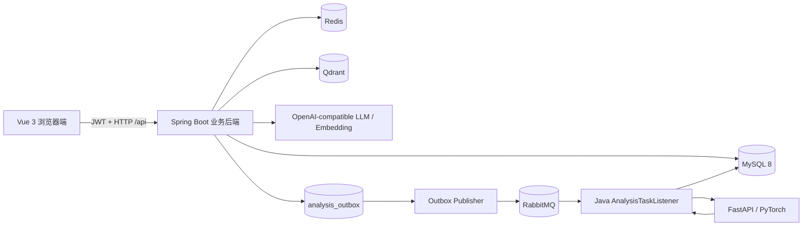
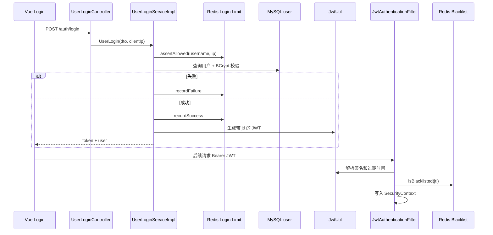
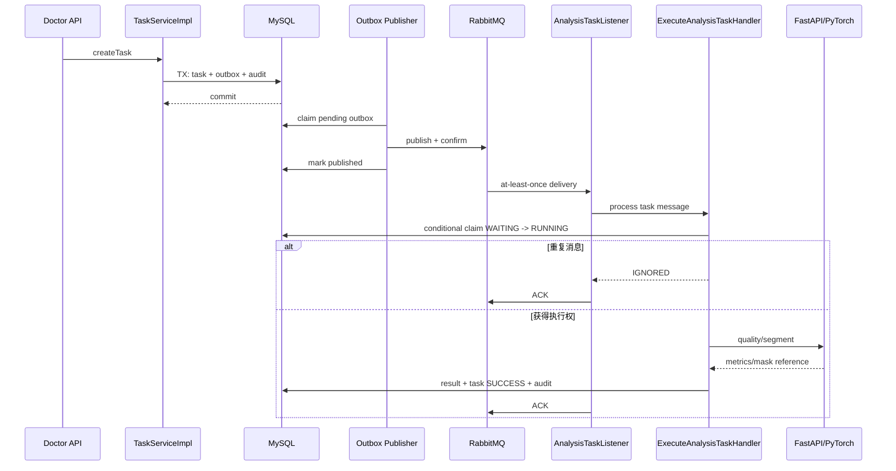
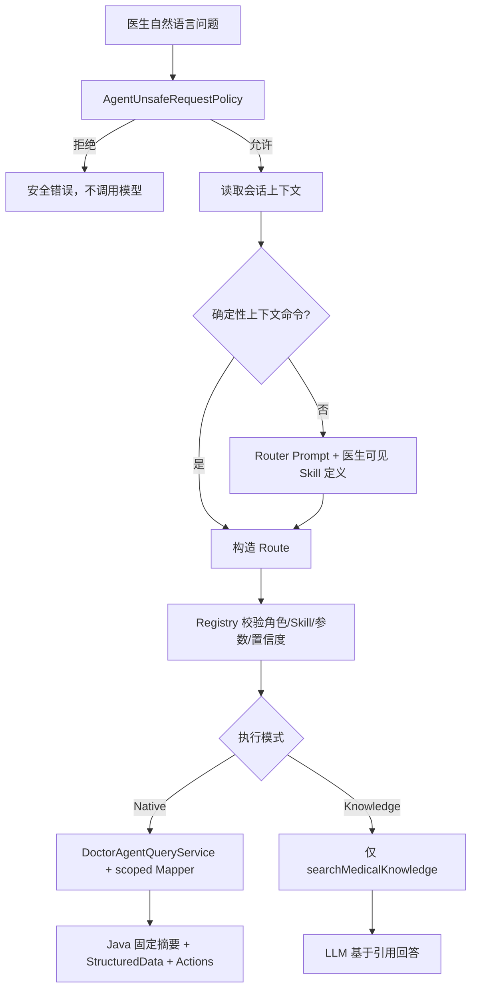
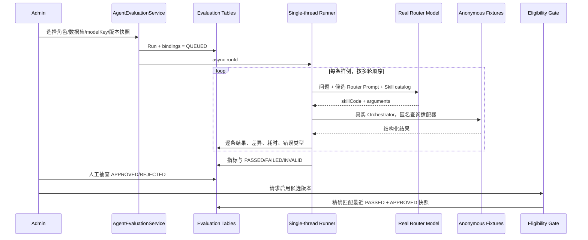

# RetinaVision 项目架构与后端代码阅读指南

> 本文面向第一次接触 RetinaVision 的开发者，也可作为项目讲解和面试复习手册。它重点说明系统为什么这样拆分、后端代码到哪里找、核心方法怎样协作，以及遇到需求时应该沿哪条调用链阅读。简单 Getter、Setter、MyBatis-Plus 基础 CRUD 和纯字段转换不逐项展开。

## 1. 文档使用方式

本文按五个问题组织：

1. **架构说明**：浏览器、Java、Python 和基础设施怎样协作。
2. **目录词典**：根目录、Java 技术层和功能子包分别负责什么。
3. **核心类/方法手册**：Controller、Service、复杂编排和关键 Mapper 从哪里进入。
4. **业务调用链**：登录、异步分析、临床审核、双角色 Agent、评测治理怎样流转。
5. **阅读路线**：开发不同功能时，应该按什么顺序读代码。

推荐先读第 2、3、4 节建立全局认识，再按自己的任务跳到第 6、7 节。文中的路径均相对于仓库根目录。

---

## 2. 系统定位与边界

RetinaVision 是一个医学影像辅助分析与多角色智能 Agent 平台。它围绕患者检查、病例、医学图像、AI 分析任务、医生审核、正式报告和知识检索形成业务闭环。

系统有四类业务角色：

| 角色 | 主要能力 | 明确边界 |
|---|---|---|
| 患者 `USER` | 创建和提交本人检查、上传图像、查看脱敏进度、读取本人已签发报告、使用患者 Agent | 不能创建技术分析任务、查看原始 mask/日志、审核或签发 |
| 医生 `DOCTOR` | 访问本人负责病例、创建分析任务、复核结果、修正、审核和签发、使用医生 Agent | 不能访问其他医生负责的病例，也不能管理平台 Prompt/Skill |
| 管理员 `ADMIN` | 用户与角色、Prompt/Skill/评测、质量控制、死信和系统状态治理 | 默认不能读取病例临床详情、原图和报告正文 |
| 研究员 `RESEARCHER` | 使用符合受众范围的知识助手 | 不能访问临床病例、任务和临床 Agent |

系统坚持两个医学安全边界：

- Python 模型、图像质量分数、分割 mask、大模型草稿和 Agent 回答都是辅助信息，不构成医学诊断。
- 正式报告只能由负责医生审核并签发，系统和大模型都不能自动完成签发。

### 2.1 部署形态：模块化单体

Java 后端是一个 **模块化单体**：最终仍然构建和运行一个 Spring Boot 应用，使用一个业务数据库，但源码按技术层和功能归属分包。这样做的理由是：

- 当前业务事务常跨病例、图像、任务、审核和报告，单体内事务更直接。
- 开发和部署成本低于微服务，不需要引入服务发现、分布式事务和跨服务鉴权。
- 通过包结构、接口、端口和 ArchUnit 测试保持边界，避免所有类重新堆回一个 `service` 文件夹。

它不是“所有代码放在一起”的传统单体，也不是独立部署的微服务集合。

---

## 3. 整体架构与组件关系



### 3.1 各组件职责

| 组件 | 负责什么 | 不负责什么 |
|---|---|---|
| Vue 3 前端 | 页面、表单、路由、状态展示、调用 Java API | 不直接访问数据库、MQ、Qdrant 或 Python；不自行判断临床权限 |
| Spring Boot | 唯一业务入口、认证授权、对象级权限、事务、状态机、异步任务、Agent 编排、审计 | 不在本进程执行 PyTorch 推理 |
| FastAPI/PyTorch | 模型加载、图像质量推理、血管分割、返回结构化模型结果 | 不接收浏览器 JWT，不查询业务数据库，不决定谁能看病例 |
| MySQL | 用户、病例、图像、任务、结果、审核、报告、Agent 和治理数据 | 不承担短周期限流和向量检索 |
| Redis | 登录失败计数、JWT 黑名单、AI 任务配额 | 不保存临床事实数据 |
| RabbitMQ | 解耦任务创建与耗时推理，承载重试和死信 | 不是任务最终状态的权威来源；任务状态以 MySQL 为准 |
| Qdrant | 知识分块向量和检索元数据 | 不保存病例或患者数据 |
| LLM/Embedding | Skill 路由、受控知识问答、报告通俗解释、向量生成 | 不直接操作数据库，不拥有写业务数据的工具 |

### 3.2 为什么浏览器只连接 Java

Java 后端是安全边界和业务事实来源。浏览器若直接调用 Python、Qdrant 或 RabbitMQ，会绕过角色校验、病例归属、状态机和审计。当前所有浏览器请求都经过 Java：前端只知道 `/api`；Java 再按内部协议访问其他组件。

### 3.3 主要数据流

- **同步业务流**：浏览器 -> Controller -> Service -> Mapper -> MySQL -> VO -> 浏览器。
- **异步推理流**：Service 事务写任务和 Outbox -> RabbitMQ -> Java Listener -> Python -> 结果/状态回写 MySQL。
- **知识流**：管理员录入文档 -> 切分和 Embedding -> Qdrant；用户提问 -> 受众过滤检索 -> LLM -> 带引用回答。
- **Agent Native Skill 流**：问题 + 可见 Skill 定义 -> LLM Router -> Java 参数/权限校验 -> 受限 SQL -> Java 结构化响应；查询结果不再发回 LLM。

---

## 4. 仓库根目录词典

```text
RetinaVision/
|-- src/                    Spring Boot 后端
|-- frontend/               Vue 3 前端
|-- ai-service/             FastAPI/PyTorch 推理服务
|-- docker/                 本地依赖与 AI 服务编排
|-- scripts/                仓库安全、布局和验收脚本
|-- docs/                   架构、后端、ADR、设计和实施文档
|-- .github/workflows/      CI 与凭据扫描
|-- API_CONTRACT.md         浏览器到 Java 的公开接口契约
|-- pom.xml                 Java 依赖与构建配置
`-- README.md               项目入口、启动和验证命令
```

### 4.1 `src/`：Java 业务后端

- `src/main/java/com/example/retinavision/`：生产 Java 代码。
- `src/main/resources/application.yaml`：非敏感默认配置和环境变量占位。
- `src/main/resources/db/migration/`：Flyway 增量迁移，是正式数据库结构演进来源。
- `src/main/resources/mapper/`：包含复杂联表、分页、统计或条件更新的 MyBatis XML。
- `src/main/resources/prompt-evaluation/`：固定 Prompt/RAG 评测样例。
- `src/test/java/`：单元、契约、架构和安全边界测试。

### 4.2 `frontend/`：Vue 3 前端

前端负责用户交互，不承载后端权限规则。常见目录：

- `src/views/`：按页面和工作区组织的视图。
- `src/components/`：复用组件。
- `src/api/`：对 Java HTTP 接口的类型化封装。
- `src/router/`：路由、角色入口和旧地址兼容。
- `src/stores/`：Pinia 登录态等共享状态。
- `src/composables/`：可复用页面状态和请求逻辑。
- `src/types/`：前端 DTO/VO 类型。
- `src/layouts/`、`src/styles/`：角色布局和统一视觉变量。

页面显示限制不能替代后端鉴权。例如患者页面隐藏“签发”按钮只是体验控制；真正的禁止签发由 Spring Security 和 Service 对象级权限共同保证。

### 4.3 `ai-service/`：Python 推理服务

- `src/retinavision_ai/api.py`：FastAPI 路由和健康检查。
- `service.py`、`inference.py`：推理用例和前后处理。
- `model_loader.py`、`model_def/`：模型定义与 checkpoint 加载。
- `quality.py`：图像质量指标。
- `schemas.py`：请求/响应模型。
- `runtime_state.py`、`config.py`：就绪状态与环境配置。
- `tests/`：不依赖真实 checkpoint 的单元测试和显式模型集成测试。
- `models/`、`storage/`、`logs/`：本地运行资产，均不应进入 Git。

Python 返回模型结果，但不理解“这个医生是否拥有这个病例”。临床授权必须在 Java 中完成。

### 4.4 `docker/`：本地一键依赖

`docker/docker-compose.yml` 编排 MySQL、RabbitMQ、Redis、Qdrant 和 Python AI 服务。端口默认只绑定 `127.0.0.1`，减少本地开发服务暴露到局域网的风险。

- `docker/.env.example`：变量名和占位示例。
- `docker/.env`：本地密码，Git 忽略。
- `docker/mysql/init.sql`：全新数据卷的初始化入口；已有数据卷的结构升级由 Flyway 完成。

### 4.5 `docs/` 与 `scripts/`

- `docs/BACKEND.md`：后端运行、配置和关键机制摘要。
- `docs/adr/`：架构决策记录，解释“为什么选这个方案”。
- `docs/superpowers/specs/`、`plans/`：历史功能设计和实施计划，不等于当前运行时文档。
- `scripts/verify-repository.ps1`：检查敏感文件、凭据和仓库卫生。
- `scripts/verify-monorepo-layout.ps1`：检查前后端、Python 和 Docker 的单仓布局。

---

## 5. Java 后端组织方式

Java 包根为 `src/main/java/com/example/retinavision`，采用“**技术职责 / 功能所有者 / 分层角色**”结构。例如病例 API 位于 `controller/cases`，病例业务接口与实现分别位于 `service/cases/api`、`service/cases/impl`，病例 SQL 位于 `mapper/cases`，病例对象位于 `pojo/cases`。复杂跨组件流程再拆到 `application`、`port` 和 `infrastructure`，避免把所有类重新堆回 `service`。

### 5.1 技术层目录词典

| 技术根目录 | 责任 | 阅读要点 |
|---|---|---|
| `controller/` | HTTP 入参、认证主体、返回包装、委托 Service | Controller 应薄；复杂状态和权限不应只写在这里 |
| `service/<功能>/api` | 面向 Controller 或其他模块的业务能力接口 | 先读接口确定该模块对外提供什么能力 |
| `service/<功能>/impl` | 业务规则、事务、权限和 Mapper 编排 | 常规业务实现；不放端口、适配器或纯工具类 |
| `application/` | 跨组件用例、流程编排、策略和确定性处理 | 当前主要承载 Agent、Analysis 执行和治理评测 |
| `port/` | Application 需要但不拥有的外部能力接口 | 只描述能力，不包含 MyBatis、HTTP、文件等实现细节 |
| `infrastructure/` | Port 或 Application API 的技术实现 | 按 agent/analysis/reporting 和 context/routing/persistence 等职责定位 |
| `mapper/` | MyBatis-Plus Mapper 和自定义数据库查询 | 基础 CRUD 不展开，重点看归属过滤、条件更新、分页统计 |
| `pojo/` | Entity、DTO、VO、Command、Event、领域对象 | 先通过对象类型判断数据处于哪一层 |
| `enumeration/` | 角色、任务、病例、质量、审核等有限状态 | 状态流转应与 Service 校验一起读 |
| `config/` | Security、RabbitMQ、Analysis Bean、评测执行器、Spring AI | 理解运行时 Bean 怎样装配 |
| `filter/auth/` | JWT 请求认证过滤器 | 每个请求怎样形成 `Authentication` |
| `mq/analysis/` | 消息协议、发布、消费、Outbox | 与 Analysis 状态机和幂等一起读 |
| `ai/analysis/` | Java 到 Python 的低层 HTTP 客户端和 DTO | `infrastructure/analysis/inference` 将其适配为 Analysis Port |
| `llm/` | 通用 LLM 网关、Prompt 和模型调用能力 | `llm/agent` 保留回答模型网关；Skill Router 适配器归入 `infrastructure/agent/routing` |
| `rag/` | 文档切分、Qdrant、受众策略、检索和引用 | 与 knowledge Service 配合 |
| `redis/shared/` | Redis Key 的集中构造 | 防止不同功能使用冲突 Key |
| `exception/<功能>`、`result/` | 按功能集中异常和统一 API 返回 | `BaseException` 表达可控业务错误，异常不散落在 Service 包中 |
| `utils/` | JWT、客户端 IP 等无状态工具 | 工具不应包含业务状态机 |

### 5.2 功能子包词典

| 功能子包 | 负责的业务 |
|---|---|
| `auth` | 注册、登录、JWT、黑名单和登录限流 |
| `user` | 用户角色、医生目录和管理员用户治理 |
| `patient` | 患者身份档案、患者检查和报告解释 |
| `cases` | 病例生命周期、医生归属、时间线和对象级访问 |
| `imaging` | 图像上传、预览、元数据和质量检查入口 |
| `analysis` | AI 任务、执行、结果、Outbox、重试、制品存储 |
| `clinical` | 人工修正、复核、审核、提醒和临床任务日志 |
| `reporting` | 报告草稿、签发、版本和 PDF 渲染 |
| `agent` | 会话、Skill 路由、上下文、医生/患者编排和工具白名单 |
| `knowledge` | 文档入库、向量索引、检索问答和知识会话 |
| `governance` | Prompt/Skill/Agent/RAG 评测、版本启用、LLM 与 Skill 审计 |
| `operations` | 统计、系统状态和死信恢复 |
| `shared` | 多功能共享但不归属某一业务的基础能力 |

### 5.3 对象命名约定

| 类型 | 典型位置 | 含义 |
|---|---|---|
| `*Entity` | `pojo/<功能>/entity` | 数据库持久化对象，通常对应表 |
| `*DTO` | `pojo/<功能>/dto` | Controller 请求或 Service 输入，不直接作为数据库模型 |
| `*VO` | `pojo/<功能>/vo` | 面向前端或调用方的输出，控制敏感字段 |
| `*Command` | `pojo/analysis/command` | 明确表达一个应用用例输入，如执行某个任务 |
| `*Event` | `pojo/analysis/event` | 跨事务/消息边界传递的事实，如任务已请求 |
| `domain/*` | `pojo/analysis/domain` | 带状态转换行为的领域对象，不依赖 Spring/MyBatis |
| `record` | 多处 | 不可变值对象和内部契约，适合参数快照和消息 |

不要把 Entity 直接返回给前端作为默认做法。VO 是隐私和兼容边界，例如患者 Agent VO 会主动排除质量阈值、模型元数据、原始路径和未签发内容。

### 5.4 `service`、`application`、`port`、`infrastructure` 如何配合

普通 CRUD 或单模块事务通常只需要 `service/<功能>/api` 与 `impl`。涉及消息、远程模型、文件或多种持久化能力的复杂流程使用下面的结构：

```text
application/analysis/
|-- usecase/ExecuteAnalysisTaskUseCase.java
`-- handler/ExecuteAnalysisTaskHandler.java

port/analysis/
|-- AnalysisTaskRepository.java
|-- AiInferencePort.java
|-- ArtifactStore.java
`-- ...

infrastructure/analysis/
|-- persistence/   MyBatis 与旧 Service 的端口实现
|-- inference/     Python HTTP 推理适配
`-- storage/       本地分析制品存储
```

`service` 回答“业务模块对外提供什么”；`application` 回答“一个完整用例如何按顺序运行”；`port` 回答“该用例依赖哪些外部能力”；`infrastructure` 回答“这些能力用 MyBatis、HTTP、文件或模型具体怎样实现”。

推理链路涉及数据库、文件、HTTP、MQ 和状态机，若直接在 Listener 里调用多个 Mapper，会很难测试。`ExecuteAnalysisTaskHandler` 只依赖 `AnalysisTaskRepository`、`AiInferencePort`、`ArtifactStore` 等端口，所以可用内存替身验证状态转换；具体实现分别放在 `infrastructure/analysis/persistence|inference|storage`。

Agent 也遵循同一边界：Orchestrator、策略、上下文命令解析在 `application/agent`，Router 工厂接口在 `application/agent/routing/api`，真实 LLM Router 适配器在 `infrastructure/agent/routing`。评测 Application 因此只依赖工厂接口，不直接构造基础设施类。

---

## 6. Controller 与 Service 能力地图

Controller 只说明“接口做什么、谁可调用、交给谁”。详细 URL 和字段以 `API_CONTRACT.md` 为准。

### 6.1 认证与用户

| 入口 | 主要接口职责 | 委托对象 |
|---|---|---|
| `controller/auth/UserLoginController` | 注册、登录、查询当前用户、退出 | `UserLoginService` |
| `controller/user/UserDirectoryController` | 给患者/医生提供可选医生目录 | `DoctorDirectoryService` |
| `controller/user/UserAdministrationController` | 管理员查看用户、调整角色和医生身份 | `UserAdministrationService` |

`UserLoginService` 是认证用例接口；`UserLoginServiceImpl` 的复杂点是密码校验、登录失败记录、JWT 生成/注销和当前用户装配。`LoginAttemptService`、`JwtBlacklistService` 将 Redis 细节隔离在认证用例之外。

### 6.2 患者、病例与图像

| 入口 | 主要接口职责 | 委托对象 |
|---|---|---|
| `PatientProfileController` | 当前患者档案、医生创建线下患者、历史档案关联 | `PatientProfileService` |
| `PatientCaseController` | 患者创建/提交/撤回检查，查询进度和正式报告 | `PatientCaseService` |
| `CaseController` | 病例列表、详情、时间线、趋势摘要 | `CaseService`、`CaseAnalysisTimelineService` |
| `ImageController` | 上传、列表、预览、删除和发起质量检查 | `ImageService`、`TaskService` |

`ClinicalAccessService` 是对象级授权中心之一：Controller 的 URL 角色校验只能说明“你是医生”，它进一步判断“这个病例是否属于当前医生”或“这个病例是否属于当前患者”。

### 6.3 分析任务、临床审核与报告

| 入口 | 主要接口职责 | 委托对象 |
|---|---|---|
| `TaskController` | 任务分页、创建、详情、取消、重试和日志 | `TaskService` + `ClinicalAccessService` |
| `ResultAnalysisController` | 分析结果详情、mask 等医生读取入口 | `AnalysisResultService` |
| `AnalysisResultComparisonController` | 结果比较与趋势 | `AnalysisResultService`/时间线服务 |
| `ResultClinicalWorkflowController` | 人工修正、审核、草稿和签发流程 | `ResultHumanWorkflowService`、报告 Service |
| `DoctorReviewController` | 医生待审核、待签发队列和提醒 | `ResultReviewService`、提醒 Service |

`TaskService` 面向同步 API；`AnalysisTaskExecutionService`/`ExecuteAnalysisTaskUseCase` 面向 MQ 执行；二者不应混淆。前者创建和管理任务，后者只消费已经持久化的任务并推进状态。

### 6.4 Agent 与知识

| 入口 | 主要接口职责 | 委托对象 |
|---|---|---|
| `AgentController` | 新建会话、会话列表、消息列表、聊天 | `AgentChatService` |
| `KnowledgeController` | 文档创建/重建/停用/删除，知识会话和问答 | `KnowledgeIngestionService`、`KnowledgeChatService` |

`AgentChatServiceImpl` 是统一聊天入口。医生和患者分别进入各自的 Orchestrator；Native Skill 命中后直接返回结构化结果，知识问题进入仅含知识检索工具的 LLM 调用。管理员不进入这两个临床 Orchestrator，而是进入带知识工具和脱敏质控治理工具的 LLM 路径。

### 6.5 治理与运维

| 入口 | 主要接口职责 | 委托对象 |
|---|---|---|
| `PromptManagementController` | Prompt 模板/版本、启用、LLM 调用日志 | `PromptTemplateService`、`LlmCallLogService` |
| `PromptEvaluationController` | 报告 Prompt 评测和人工评审 | Prompt 评测 Service |
| `RagEvaluationController` | RAG 检索和引用评测 | RAG 评测 Service |
| `AgentSkillController` | Skill/版本、单 Skill 评测适配、启用 | `AgentSkillAdministrationService` |
| `AgentEvaluationController` | 数据集、运行、进度、结果、取消、人工评审 | `AgentEvaluationService`、`AgentEvaluationAdministrationService` |
| `QualityControlController` | 模型表现、审核统计和风险告警 | `QualityControlService` |
| `StatisticsController`、`SystemStatusController` | 管理看板和依赖服务状态 | operations Service |
| `DeadLetterController` | 查看和恢复死信任务 | `DeadLetterRecoveryService` |

这些治理接口均由 `SecurityConfig` 限定为 `ADMIN`。管理员能治理模型和版本，并不自动获得临床数据读取权。

---

## 7. 核心类与方法手册

本节只深入会改变状态、跨组件编排、实施安全边界或保证幂等的方法。接口中的简单查询方法可把它理解为“能力目录”，实现细节按需要进入对应 `impl`。

### 7.1 认证、Token 与 Redis

#### `SecurityConfig.filterChain(...)`

路径：`config/auth/SecurityConfig.java`

它建立第一层 URL 角色边界：

1. 关闭表单登录、Basic 和服务端 Session，采用无状态 JWT。
2. 只放行注册、登录、OPTIONS 和错误转发。
3. 将管理、临床、患者和知识接口映射到对应角色。
4. 把 `JwtAuthenticationFilter` 放到用户名密码过滤器之前。
5. 统一返回 JSON 形式的 401/403，而不是 HTML 登录页。

这一层只能回答“角色是否允许访问某类 URL”，不能回答“这个病例是否属于当前用户”，所以后面仍需要对象级校验。

#### `JwtAuthenticationFilter.doFilterInternal(...)`

路径：`filter/auth/JwtAuthenticationFilter.java`

请求流转：

```text
Authorization: Bearer token
  -> JwtUtil.parseToken
  -> 检查 jti 是否进入 Redis 黑名单
  -> 读取 subject / username / roleCode
  -> 构造 CurrentUserVO 和 ROLE_xxx Authority
  -> 写入 SecurityContextHolder
  -> Controller 从 Authentication 取得当前用户
```

`SecurityContextHolder` 默认使用当前请求线程的上下文。请求结束后由 Spring Security 清理，不应把其中用户对象缓存到全局变量或异步线程中。

Redis 不可用时黑名单检查采取 **认证失败关闭**：返回 503，而不是放行一个无法确认是否已注销的 Token。格式错误、过期或黑名单 Token 返回 401。

#### `UserLoginServiceImpl.UserLogin(...)` 与 `logout(...)`

路径：`service/auth/impl/UserLoginServiceImpl.java`

- `UserLogin(...)` 先让 `LoginAttemptService.assertAllowed` 检查用户名/IP，再校验 BCrypt 密码；失败计数，成功清除用户名维度失败状态并签发 JWT。
- JWT 包含用户 ID、用户名、角色和唯一 `jti`。密码和数据库实体不进入 Token。
- `logout(...)` 解析当前 Token，把 `jti` 以“Token 剩余有效期”为 TTL 写入黑名单。这样黑名单 Key 会在原 Token 自然过期时自动清除。

#### `RedisLoginAttemptService`

路径：`service/auth/impl/RedisLoginAttemptService.java`

它使用 Redis String 计数器，分别限制规范化用户名和客户端 IP。`CHECK_SCRIPT`/`RECORD_SCRIPT` 用 Lua 在一次服务器端执行中完成读计数、递增和首次设置 TTL，解决普通 `INCR` 与 `EXPIRE` 分开发送时进程中断造成“永不过期 Key”的问题。

登录限流采用可用性优先的降级策略：Redis 操作异常会记录日志但不把所有用户永久锁在登录页；JWT 黑名单则采用更严格的安全优先策略。两个功能的故障策略不同，是因为风险不同。

#### `RedisAiTaskQuotaService.reserve(...)` / `release(...)`

路径：`service/analysis/impl/RedisAiTaskQuotaService.java`

配额使用两类 String 计数器：用户每分钟 Key 和用户每日 Key。Lua 原子完成：

1. 读取两个计数。
2. 任一达到上限则不增加，并返回当前值。
3. 同时递增分钟/日计数。
4. 首次创建时设置到下一时间窗口的 TTL。

`reserve(...)` 返回 `AiQuotaReservation`，其中保留两个 Key。若后续数据库事务失败，`TaskServiceImpl.registerQuotaRollback(...)` 在事务完成回调中调用 `release(...)` 做补偿，避免用户“任务没创建却损失一次配额”。

### 7.2 对象级临床访问

#### `ClinicalAccessServiceImpl`

路径：`service/cases/impl/ClinicalAccessServiceImpl.java`

核心方法：

- `assertClinicalRole(...)`：确认调用者是允许的临床角色。
- `assertCanAccessCase(...)`：患者只能访问本人档案下病例，医生只能访问 `assigned_doctor_id` 为自己的病例。
- `assertCanAccessImage/Task/Result(...)`：先从子对象反查所属病例，再复用病例权限。
- `assertCanModifyCase/Image(...)`：在读取权限基础上增加角色和状态要求。

越权和不存在尽量返回同样的“资源不存在”，避免攻击者通过 403/404 差异枚举病例是否存在。这一规则比单纯在 Controller 加 `hasRole` 更重要。

#### SQL 层的第二道边界

列表、Agent 查询和临床队列不能“先查全部再在 Java 过滤”。`src/main/resources/mapper/CaseMapper.xml`、`src/main/resources/mapper/DoctorAgentQueryMapper.xml`、`src/main/resources/mapper/PatientAgentQueryMapper.xml` 在 SQL 中带入当前 `doctorId` 或 `patientUserId`：

- 医生查询条件包含负责医生 ID。
- 患者查询先由账号定位 `patient_profile`，再限定病例归属。
- 报告查询额外限定已签发状态。

这样可避免分页总数泄露、内存过滤漏项，也降低未来某个 VO 转换忘记过滤的风险。

#### 患者档案与病例归属

路径：`service/patient/impl/PatientProfileServiceImpl.java`、`service/cases/impl/CaseServiceImpl.java`

- `getOrCreateAccountProfile(...)` 保证患者账号有唯一匿名档案，业务表使用匿名患者编号而不是把登录名当临床标识。
- `requireDoctorAccessible(...)` 只允许档案创建医生或已经负责该患者病例的医生访问档案。
- `linkLegacy(...)` 由管理员把历史匿名档案关联到患者账号；对已有病例的档案不做危险的自动合并。
- `CaseServiceImpl.addCase(...)` 区分患者本人建检查和医生为可访问匿名患者建病例，并在创建时确定负责医生。
- `assignDoctor(...)` 只允许患者本人在可变更阶段选择医生；病例提交或已有分析任务后禁止换医生，避免历史任务归属失真。
- `submit(...)` / `withdraw(...)` 执行病例 workflow 的前置状态检查，而不是接受前端任意写状态值。

`CaseServiceImpl.getCaseList(...)` 在查询阶段按账号患者档案或负责医生过滤，并对患者响应移除医生诊断备注。这里同时体现“行级过滤”和“字段级最小化”。

#### 图像上传和删除

路径：`service/imaging/impl/ImageServiceImpl.java`

`uploadImage(...)` 先校验病例修改权限，再检查文件大小、扩展名和 MIME，生成受控 object key，保存文件和元数据，并创建图像质量检查任务。不能只信浏览器上传的文件名或 Content-Type。

`resolveStoragePath(...)` 会规范化目标路径并验证其仍在上传根目录内；`deleteImage(...)` 在存在运行中任务或成功结果时拒绝删除，避免任务引用的输入突然消失；`requestQualityCheck(...)` 根据当前质量状态选择幂等返回、拒绝重复或重新检查。

### 7.3 任务创建、Outbox 与配额补偿

#### `TaskServiceImpl.createTask(...)`

路径：`service/analysis/impl/TaskServiceImpl.java`

这是任务创建的核心事务：

1. 校验 DTO、病例和图像存在且未软删除。
2. 校验图像属于所传病例，病例/图像状态允许执行。
3. 查询同一图像同一类型的未完成任务，阻止重复提交。
4. 血管分割任务先在 Redis 预留配额。
5. MySQL 写入 `analysis_task`，初始状态为 `WAITING`。
6. 必要时推进病例 workflow，并更新质量检查状态。
7. **同一数据库事务**写入 `analysis_outbox`，而不是直接依赖一次 MQ 网络调用。
8. 写任务状态审计日志。
9. 事务失败时释放已预留的 Redis 配额。

采用 Outbox 的原因是无法让 MySQL 事务和 RabbitMQ Broker Confirm 组成一个简单本地事务。如果“先提交数据库、再发 MQ”时进程崩溃，任务会永远停在等待；Outbox 把“需要发消息”也先持久化，后台可以反复补发。

#### `AnalysisOutboxPublisher.publishDueEvents()`

路径：`mq/analysis/outbox/AnalysisOutboxPublisher.java`

定时发布器先恢复超时的 `PROCESSING` 记录，再批量选择到期 `PENDING` ID。每条记录通过条件更新 claim，只有 claim 成功的实例能发送。Publisher Confirm 成功后标记 `PUBLISHED`；失败则增加 attempt、记录脱敏错误并计算下次重试时间。

`claimPending`、`markPublished`、`reschedule` 都是条件更新，防止多实例同时处理或旧处理者覆盖新状态。

#### `TaskServiceImpl.retryTask(...)`

只允许 `FAILED` 且未超过 `maxRetryCount` 的任务重试。它重新校验病例/图像、预留配额、原子更新重试次数和状态，并重新投递。这里保留了旧的直接 Publisher 路径，阅读时应区分“首次创建走 Outbox”和“人工重试重新投递”。

### 7.4 消费、幂等与推理执行

#### `AnalysisTaskListener.handleAnalysisTask(...)`

路径：`mq/analysis/AnalysisTaskListener.java`

Listener 使用手动 ACK，根据执行结果处理消息：

| `ExecutionDisposition` | RabbitMQ 动作 | 含义 |
|---|---|---|
| `SUCCESS` | ACK | 任务成功 |
| `IGNORED` | ACK | 重复消息或任务状态已不适合执行 |
| `REQUEUE` | NACK + requeue | 数据暂时不可见，稍后重试 |
| `FAILED` | 发布延迟重试；耗尽后 NACK 不重入队 | 进入有限重试或死信 |

消息系统提供至少一次投递，业务幂等不能只靠 RabbitMQ。真正的防重复在数据库任务 claim。

#### `ExecuteAnalysisTaskHandler.execute(...)`

路径：`application/analysis/handler/ExecuteAnalysisTaskHandler.java`

执行步骤：

1. 读取任务；不存在暂时 `REQUEUE`。
2. 只有 `WAITING/RETRYING` 可进入执行，其他状态返回 `IGNORED`。
3. 领域对象 `task.claim(...)` 生成状态转换；Repository 用条件更新抢占。影响行数为 0 说明另一个消费者已经处理。
4. 按任务类型调用 `AiInferencePort.checkQuality(...)` 或 `segment(...)`。
5. 分割任务下载 mask，经 `ArtifactStore.storeMask(...)` 保存到受控结果根目录，再保存结构化结果并确保报告草稿存在。
6. 成功更新 `SUCCESS` 并写审计；异常只保存通用失败提示，避免内部路径和堆栈暴露给前端。

`executeClaimedTask(...)` 把质量检查与分割分支集中在一个用例中；`failTask(...)` 保证失败状态和审计一致。

#### `LocalArtifactStore`

路径：`infrastructure/analysis/storage/LocalArtifactStore.java`

`resolveSource(...)`、`storeMask(...)` 会对配置根目录和目标路径做规范化，要求最终路径仍在允许根下。原因是数据库中的 object key 不能被无条件当作系统绝对路径，否则可能形成路径穿越。

### 7.5 人工修正、审核和报告签发

#### `ResultHumanWorkflowServiceImpl.addCorrection(...)`

路径：`service/clinical/impl/ResultHumanWorkflowServiceImpl.java`

该方法验证结果、上传类型、图像可解码性和尺寸，再生成二值 mask、保存受控文件并创建递增版本的 Correction。若数据库保存失败，清理已写文件，避免孤立制品。

私有 `resolve(...)` 是安全方法：规范化路径并验证仍位于结果根目录。`binary(...)` 把人工修正统一成可比较的二值格式。

#### `ResultReviewServiceImpl.review(...)`

路径：`service/clinical/impl/ResultReviewServiceImpl.java`

审核不是简单备注：Service 要求当前结果存在、操作者具备医生身份、审核结论和意见满足规则，并保存审核版本。病例归属由 `ResultClinicalWorkflowController.authorize(...)` 在调用 Service 前通过 `ClinicalAccessService.assertCanAccessResult(...)` 校验；因此该 Service 目前不能被不经过授权入口的内部调用者直接视为安全边界。报告签发会再次检查审核是否完整，不能仅依赖前端按钮顺序。

#### `AnalysisReportServiceImpl`

路径：`service/reporting/impl/AnalysisReportServiceImpl.java`

核心方法：

- `getOrCreateDraft(...)`：为分析结果取得或创建草稿。
- `updateDraft(...)`：仅允许草稿状态更新，避免修改已签发版本。
- `sign(...)`：签发核心事务；要求结果、完整医生意见、医生身份和必要数据均满足条件，渲染 PDF，计算文件摘要，保存不可变版本，并推进所属病例完成状态。病例归属仍由 Controller 的 `authorize(...)` 在进入 Service 前校验。
- `getFile(...)`：只返回已持久化报告版本对应的受控文件。

`sign(...)` 先生成目标文件再持久化元数据，因此异常路径必须调用 `cleanup(...)`。已签发报告通过版本号和摘要保持可追踪；后续修改应产生新版本，而不是覆盖原 PDF。

### 7.6 双角色 Agent 编排

#### `AgentChatServiceImpl.chat(...)`

路径：`service/agent/impl/AgentChatServiceImpl.java`

它是 Agent 总入口：

1. 校验问题和会话所有权，读取最近 10 条历史。
2. `DOCTOR` 交给 `DoctorAgentSkillOrchestrator`；`USER` 交给 `PatientAgentSkillOrchestrator`；`ADMIN` 跳过这两个临床 Native Orchestrator。
3. Native Skill 命中时，Java 直接保存结构化响应和 Skill 审计，不再调用回答 LLM。
4. 医生/患者 Native Skill 未处理的知识问题按角色选择 Prompt，并只注册 `searchMedicalKnowledge` 白名单工具；管理员调用无该显式 allowlist 的工厂重载，获得知识检索与脱敏质控治理工具。
5. 对 LLM 输出执行 `LlmSafetyPolicy`，记录成功/失败、耗时和版本。

`requireOwnedSession(...)` 用 `session.user_id == currentUser.id` 保证不同用户不能读取彼此对话。医生和患者不共享 Orchestrator、Skill 集合、查询 Service 或上下文结构。

#### `AgentUnsafeRequestPolicy.requireAllowed(...)`

路径：`application/agent/policy/AgentUnsafeRequestPolicy.java`

该策略在 Router 之前确定性拒绝：绕过规则、明确写操作、读取其他患者/医生、未签发报告、任务日志、文件路径和原始 mask。安全拒绝不依赖 LLM 是否“听话”。解释性问题先被识别，避免把“签发是什么意思”误判成签发命令。

#### `AgentSkillRegistry`

路径：`application/agent/routing/AgentSkillRegistry.java`

- `isAvailable(...)`：医生 Skill 与患者 Skill 使用两个显式集合。
- `executionMode(...)`：标记 Native `DIRECT` 或受控工具模式。
- `argumentSchema(...)`：每个 Skill 允许的参数和值域。
- `validateAndNormalize(...)`：Router 返回后再次检查角色、未知参数、枚举和值格式。

LLM 只负责“从自然语言提出候选路由和参数”，Java Registry 才是执行边界。模型返回不存在的 Skill、患者返回医生 Skill 或非法枚举都不会执行。

#### `LlmAgentSkillRouter.route(...)`

路径：`infrastructure/agent/routing/LlmAgentSkillRouter.java`

`writeContext(...)` 把自然语言问题、当前 Skill、**本角色本会话可用**的 Skill 定义、少量路由样例和参数 Schema 组装为 JSON，再使用版本化 `AGENT_SKILL_ROUTER` Prompt 调用模型。返回值必须是合法 JSON，Skill 必须在传入目录内，置信度必须有效；模型不能通过“猜到一个代码”获得未提供能力。

#### 医生 Orchestrator

路径：`application/agent/orchestration/DoctorAgentSkillOrchestrator.java`

`handle(...)` 的关键顺序：安全策略 -> 加载会话上下文 -> 解析“下一页/查看第二个”等确定性命令 -> Router -> 置信度门槛 -> Registry 参数校验 -> Native Skill 分派 -> 绑定实际 Skill 版本。

Native 分支包括工作量、负责病例筛选、病例摘要、随访比较、任务查询和临床队列。`DoctorAgentQueryServiceImpl` 始终把当前医生 ID 传给 `DoctorAgentQueryMapper`；Java 只组装摘要、分页、引用和受控页面动作。

#### 患者 Orchestrator

路径：`application/agent/orchestration/PatientAgentSkillOrchestrator.java`

患者 Skill 仅包括 `MY_CASE_LIST`、`MY_CASE_PROGRESS`、`MY_SIGNED_REPORT`、`PATIENT_KNOWLEDGE_QA`。`listCases(...)`、`progress(...)`、`reports(...)` 通过 `PatientAgentQueryService` 查询当前账号关联患者；报告详情只接受已签发报告。

`action(...)` 对前端跳转路径做白名单校验，仅允许病例进度、报告区和图像上传。患者 Agent 不生成任意 URL，也没有创建任务、撤回、删除、审核或签发动作。

#### 多轮上下文

`PersistentAgentQueryContextService` 和 `PersistentPatientAgentQueryContextService` 把当前 Skill、筛选、页码、当前页带类型引用、选中病例/任务/报告写入 `agent_query_context`。后续“下一页”“查看第二个”“解释这份报告”由 `AgentContextCommandParser` 或患者 Parser 确定性解析。

存储对象 ID 而不是把整页临床数据塞进聊天历史，既减少 LLM 暴露，也避免文本指代错误。选择序号必须落在当前页引用范围内。

`AgentSkillVersionBindingService.resolve(...)` 在某个会话第一次使用 Skill 时记录版本；管理员后来切换启用版本，既有会话仍使用原绑定，避免同一段多轮对话中参数契约突然改变。

### 7.7 知识 RAG 与工具白名单

#### `KnowledgeIngestionServiceImpl`

路径：`service/knowledge/impl/KnowledgeIngestionServiceImpl.java`

文档入库负责保存文档元数据、切分、生成 Embedding、写入 Qdrant，并记录索引状态。重建索引使用同一受众和文档 ID，停用文档后检索侧不应再返回。

`rejectSensitiveContent(...)` 在入库前拒绝疑似 API Key、Bearer Token、绝对路径和患者身份字段，避免把凭据或隐私永久向量化。

#### `KnowledgeChatServiceImpl`

路径：`service/knowledge/impl/KnowledgeChatServiceImpl.java`

它校验会话所有权，依据当前角色应用 `KnowledgeAudiencePolicy`，检索真实 chunk，构造带编号引用的上下文，再调用模型。回答中的引用必须能回指本轮命中的 chunk；低相关或无结果时走明确兜底，不让模型凭空补医学事实。

`RagGroundingValidator.validate(...)` 要求引用 chunk 来自本轮命中、quote 确实是原文子串、长度合法且不重复。引用格式正确但来源不存在，同样判定失败。

#### `DefaultAgentToolFactory.create(...)`

路径：`application/agent/tooling/DefaultAgentToolFactory.java`

工具工厂按角色和显式 allowlist 创建 Spring AI `ToolCallback`。当前医生/患者知识问答只注册 `searchMedicalKnowledge`。管理员使用 `create(sessionId, user, traceId)`，获得公共知识工具以及 `getQualityControlOverview`、`listQualityRiskAlerts` 两个不返回患者身份的治理工具。类中虽还定义了临床工具，但本轮医生/患者知识回退并未注册它们；未注册的工具对模型不可见。

`SpringAiAgentModelGateway.generate(...)` 还限制最大工具轮次和总调用次数，并关闭并行工具调用，避免模型在一次回答中并发触发无法预测的查询组合。

`AuditedTools.execute(...)` 统一记录工具名、脱敏参数摘要、成功状态和耗时，并收集引用。完整病例对象、原始 Prompt 和大段工具结果不进入常规审计。

### 7.8 Agent 评测与版本启用

#### `AgentEvaluationService.start(...)`

路径：`application/governance/evaluation/usecase/AgentEvaluationService.java`

启动时校验数据集状态、目标角色、受控 `modelKey` 和版本映射；同一时间只允许一个 `QUEUED/RUNNING` 真实模型运行。它创建 Run，并把本次 Prompt、Skill、模型和数据集版本写入 binding 快照，然后提交到独立单线程执行器。

#### `AgentEvaluationRunner.run(...)`

Runner 按场景/轮次顺序加载样例，逐条调用 `AgentEvaluationCaseExecutor`，持久化实际 Skill、参数、断言、耗时和失败类型。每条之间检查取消标志：当前模型请求完成后停止后续样例。

- 模型超时、429、服务不可用等基础设施问题使运行进入 `INVALID`。
- 用户取消进入 `CANCELLED`。
- 可判定的路由、参数、结构或安全错误进入正常评分，最终可能 `FAILED`。

#### Fixture 隔离

`DefaultAgentEvaluationCaseExecutor` 使用真实 Router 和 Orchestrator，但把查询依赖替换成 `FixtureDoctorAgentQueryService`、`FixturePatientAgentQueryService`、内存上下文和固定 RAG 片段。它不读取病例表、不写正式 Agent 会话和 Skill 执行日志。

这使“真实模型理解能力”与“真实患者数据”解耦。自动化测试进一步替换模型适配器，不消耗外部 API 配额。

#### `AgentEvaluationScorer`

评分聚合路由、参数、查询断言、结构、安全、引用和延迟。当前门槛：路由 >= 90%、参数 >= 95%、查询 >= 95%、结构/安全/引用 = 100%、有效样例 P95 <= 5 秒。出现跨患者/跨医生、未签发内容、技术字段或写操作等严重安全失败时整次直接失败。

#### `AgentEvaluationEligibilityService` 与版本激活

自动评分通过并不等于可启用。候选 Skill 或关键 Router Prompt 必须找到最近一次同时满足以下条件的运行：

- `PASSED` 且人工 `APPROVED`。
- 角色和数据集版本匹配。
- 当前受控模型配置匹配。
- Run binding 包含要启用的候选版本以及配套 Prompt/Skill 完整快照。

`AgentSkillAdministrationServiceImpl.activate(...)` 和 Prompt 激活流程调用资格检查。历史已启用版本不被迁移强制停用；下一次切换才执行新门槛。

#### 调用审计与运维视图

`LlmCallLogServiceImpl.record(...)` 使用独立事务记录模型调用结果，业务事务回滚时仍能保留故障线索。评测调用带 `callSource=EVALUATION` 和 `evaluationRunId`，常规业务日志列表默认只展示 `BUSINESS`，防止大批评测数据污染运行看板。

`DefaultAgentToolFactory.AuditedTools.execute(...)` 统一记录工具摘要、成功状态、耗时和错误类型；`SystemStatusServiceImpl`、`StatisticsServiceImpl`、`QualityControlServiceImpl` 分别提供依赖状态、任务/队列统计和质量风险；`DeadLetterRecoveryServiceImpl` 只允许管理员恢复死信，并跳过已被新质量任务替代的旧消息。

---

## 8. 核心 Mapper 与数据库边界

基础 `insert/selectById/updateById` 由 MyBatis-Plus 提供，不逐项说明。应重点阅读以下自定义 Mapper：

| Mapper | 为什么重要 |
|---|---|
| `CaseMapper` / XML | 病例分页、患者/医生归属、病例与图像联表 |
| `TaskMapper` / XML | 任务分页、未完成去重、条件 claim、状态统计 |
| `DoctorAgentQueryMapper` / XML | 所有医生 Agent 查询在 SQL 中限定 `assigned_doctor_id` |
| `PatientAgentQueryMapper` / XML | 患者账号到档案再到病例，且只取允许展示字段 |
| `AnalysisOutboxMapper` / XML | pending 选择、claim、发布完成、失败重排和过期恢复 |
| `StatisticsMapper` / XML | 管理看板聚合，避免 Service 循环扫描 |
| `QualityControlMapper` / XML | 模型版本表现、审核差异和风险聚合 |
| `AgentEvaluation*Mapper` | 数据集、Run、版本 binding 和逐样例结果快照 |

### 8.1 表按领域分组

| 表组 | 主要实体关系 |
|---|---|
| 身份 | `user` 与患者档案/医生身份关联 |
| 临床主链 | `patient_profile -> case -> image_file -> analysis_task -> analysis_result` |
| 人工闭环 | `analysis_result -> correction / feedback / review -> analysis_report` |
| 异步可靠性 | `analysis_task -> analysis_outbox`，任务另有关联状态日志 |
| 知识 | document -> chunk；chat session -> message；向量正文在 Qdrant |
| Agent | skill -> skill_version；session -> message/context/version binding/tool log |
| 治理 | prompt -> version；evaluation dataset -> case；run -> binding/result |

数据库迁移以 `src/main/resources/db/migration/V*__*.sql` 的版本顺序为准。不要直接修改旧迁移来适配已有环境，应新增更高版本迁移。

---

## 9. 业务调用链

### 9.1 登录、认证与退出



退出时 `UserLoginServiceImpl.logout(...)` 将 `jti` 写入 Redis，TTL 等于 Token 剩余寿命。下一请求在 Filter 阶段被拒绝。JWT 无状态并不意味着“无法注销”，黑名单实现了服务端提前失效。

### 9.2 患者检查到正式报告

```text
患者建立/关联档案
  -> 创建草稿病例并选择医生
  -> 上传医学图像
  -> 提交检查
  -> 负责医生查看病例和质量状态
  -> 医生决定是否创建血管分割任务
  -> 异步推理生成结果
  -> 医生人工修正/反馈/审核
  -> 更新报告草稿
  -> 医生签发 PDF
  -> 病例完成
  -> 患者只能查看已签发版本
```

关键边界：

- 患者提交前可修改允许的草稿；提交后由 workflow 状态限制撤回和修改。
- 图像质量只给建议，不能替医生自动创建分割任务。
- 医生必须是病例 `assigned_doctor_id`。
- 报告签发再次检查审核完整性，不能通过直接调用接口跳过页面步骤。
- 患者报告接口和患者 Agent Mapper 都限定 `SIGNED`，草稿不会因前端错误而泄露。

### 9.3 异步分析可靠性



可靠性由多层共同完成，而不是某个“绝不丢消息”开关：

1. Outbox 解决数据库提交与 MQ 发布之间的崩溃窗口。
2. Publisher Confirm 证明 Broker 接收了消息。
3. 手动 ACK 确保执行完成前消息不会被删除。
4. 条件 claim 让重复消息只有一个执行者。
5. 有限重试和死信避免无限循环。
6. MySQL 任务状态和审计日志是最终事实，RabbitMQ 只是传输通道。

### 9.4 医生 Agent 查询



Router 输入包含问题、当前角色可见 Skill 目录和 JSON 参数契约；不包含病例列表、任务日志或未签发报告。Native 查询结果直接由 Java 返回，避免二次 LLM 改写造成事实漂移和临床数据外发。

医生数据隔离同时存在于三层：

- `AgentSkillRegistry` 不允许患者 Skill 混入医生路径，反之亦然。
- Orchestrator 必须接收 `CurrentUserVO` 且检查 `DOCTOR`。
- `DoctorAgentQueryMapper` 的 SQL 强制使用当前医生 ID 过滤。

### 9.5 患者 Agent 查询

患者路径与医生路径结构相似，但不是共用一个“大而全查询 Service”：

```text
AgentChatServiceImpl
  -> PatientAgentSkillOrchestrator
  -> PatientAgentQueryService
  -> PatientAgentQueryMapper(patientUserId)
  -> 患者专用 VO（通俗质量状态、进度、已签发报告）
```

患者只看到“正常/建议重传”等通俗质量状态和原因，不看到阈值、置信度、模型名、mask 路径、任务日志和完整结果 JSON。报告解释先通过对象权限和签发状态校验，再只把允许字段交给解释模型；解释失败不影响原正式报告。

### 9.6 Agent 真实模型评测与启用



评测数据集总计 180 条固定匿名样例，覆盖医生正常查询、患者正常查询、分页/指代/多轮、RAG 路由与引用、越权/写操作/提示词注入。固定编号如 `EVAL-C-*`、`PT-EVAL-*` 不对应真实患者。

当前 v2 构成为：医生 60 条正常查询 + 15 条上下文 + 10 条 RAG + 15 条安全，共 100 条；患者 40 条正常查询 + 15 条上下文 + 10 条 RAG + 15 条安全，共 80 条。语料由 `src/main/resources/db/migration/V24__agent_evaluation_calibration.sql` 固定版本化。

一次运行冻结版本的原因是：如果运行中途 Skill 或 Prompt 被切换，最终准确率无法说明到底评了哪个版本。Binding 快照使结果可复现，也让启用门槛能精确匹配候选版本。

### 9.7 知识文档到带引用回答

```text
管理员创建文档
  -> KnowledgeIngestionService 校验元数据和 audience
  -> 文本切分为 chunk
  -> Embedding
  -> Qdrant upsert（文档 ID、chunk ID、受众等元数据）

用户提问
  -> 校验知识会话所有权
  -> 角色映射 audience
  -> Qdrant 向量检索并过滤 ACTIVE 文档/受众
  -> 只把命中 chunk 交给 LLM
  -> 校验回答引用来自本轮命中
  -> 保存脱敏会话消息并返回 citations
```

RAG 评测关注召回、排名和引用；Agent 评测只验证 Agent 是否正确选择知识路径、受众是否正确以及引用是否真实连接。两个评测职责不同。

---

## 10. 状态、事务与一致性

### 10.1 哪些状态值得优先理解

| 领域 | 关键状态 | 主要维护位置 |
|---|---|---|
| 病例 | 草稿、已提交、处理中、完成等 workflow | Patient/Case Service |
| 图像质量 | 未检查、检查中、可用、建议重传、错误 | Image/Task/质量 Projection |
| 分析任务 | `WAITING -> RUNNING -> SUCCESS/FAILED`，另有重试/取消 | Task Service + Analysis 领域对象 |
| 审核 | 待审核、审核意见/结论 | ResultReviewService |
| 报告 | 草稿、已签发的版本 | AnalysisReportService |
| Outbox | `PENDING -> PROCESSING -> PUBLISHED`，失败回 PENDING | AnalysisOutboxPublisher |
| 评测 | `QUEUED/RUNNING/PASSED/FAILED/INVALID/CANCELLED` | AgentEvaluationRunner |

修改状态时要同时检查：允许的前置状态、操作者权限、更新时间、审计记录、关联对象是否也要推进、失败是否需要补偿。

### 10.2 事务边界

- 创建任务：任务、Outbox、病例/图像状态和审计应在同一 MySQL 事务。
- 人工审核/修正元数据：数据库写入应原子；文件写入失败或数据库回滚时要清理制品。
- 报告签发：审核校验、报告版本、文件摘要和病例完成状态应作为一个用例处理。
- Redis 与 MySQL 无法共享本地事务：先预留 Redis 配额，再用事务回调补偿。
- MQ 与 MySQL 不共享事务：任务创建侧使用 Outbox 和幂等消费处理这个边界。需要注意，当前 `AnalysisTaskExecutionServiceImpl.process(...)` 整体标注 `@Transactional`，所以 Python 推理、mask 下载和文件写入实际仍位于该数据库事务调用范围内，可能形成长事务；维护或重构时不能误以为远程调用已与事务拆开。

### 10.3 错误信息与审计

对前端和持久化审计只保存有限、脱敏的错误摘要；堆栈、绝对路径、完整 Prompt、API Key、原始模型响应和临床大对象只应出现在受控运行日志或根本不记录。

---

## 11. 配置与运行时装配

### 11.1 `application.yaml`

仓库配置文件只保留非敏感默认值和 `${ENV_VAR}` 引用。数据库密码、RabbitMQ 密码、JWT Secret、LLM/Embedding API Key 应来自环境变量或被 Git 忽略的本地 profile。

主要配置域：

- `spring.datasource`、Flyway、MyBatis。
- `spring.rabbitmq` 和 `retina.mq`/`retina.outbox`。
- Redis 开关和限流/配额阈值。
- AI 服务 URL、上传/结果根目录。
- LLM、Embedding、Qdrant 和模型白名单。
- 评测执行器和医生提醒参数。

### 11.2 关键配置类

| 类 | 作用 |
|---|---|
| `SecurityConfig` | URL 角色、无状态 JWT、异常响应、CORS |
| `RabbitMqConfig` | 主/重试/死信交换机和队列、手动 ACK、Publisher Confirm |
| `AnalysisModuleConfiguration` | Analysis 用例、端口和适配器装配 |
| `SpringAiModelConfiguration` | Chat/Embedding 网关按配置启用 |
| `AgentEvaluationExecutorConfig` | 独立单线程真实模型评测执行器 |
| `PromptEvaluationExecutorConfig` | Prompt 评测执行器 |

---

## 12. 测试体系

### 12.1 测试分层

| 类型 | 验证内容 |
|---|---|
| 单元测试 | 状态机、参数归一化、安全策略、评分器、上下文解析 |
| Service/契约测试 | 事务用例、对象级权限、Fixture 行为、Mapper 契约 |
| MVC/Security 测试 | URL 角色、401/403、请求/响应契约 |
| ArchUnit | 技术根下必须使用功能子包；Analysis 领域和端口依赖边界 |
| 前端 type-check/build | Vue 类型、路由和生产构建 |
| Python pytest | 推理协议、质量逻辑和模型加载；真实 checkpoint 测试显式分组 |
| 仓库脚本 | 凭据、运行时文件和 monorepo 布局 |

### 12.2 常用验证命令

```powershell
# Java 全量测试
mvn test

# 前端
npm.cmd --prefix .\frontend run type-check
npm.cmd --prefix .\frontend run build

# Python（不需要真实 checkpoint）
python -m pytest -q .\ai-service\tests -m "not model_integration"

# 仓库和布局
powershell -ExecutionPolicy Bypass -File .\scripts\verify-repository.ps1
powershell -ExecutionPolicy Bypass -File .\scripts\verify-monorepo-layout.ps1
```

自动化测试默认不调用真实 LLM。真实模型 Agent 评测是管理员手动触发的治理流程，不能用一次在线调用替代可重复的单元测试。

---

## 13. 按需求阅读代码的路线

### 13.1 第一次阅读整个后端

1. `README.md`：部署组件和角色。
2. `config/auth/SecurityConfig.java`：接口角色地图。
3. `controller/`：有哪些外部用例。
4. 对应 `service/<功能>/api` 接口：能力边界。
5. `service/<功能>/impl`：复杂规则和事务。
6. `mapper/<功能>` + XML：数据归属和条件更新。
7. `pojo/<功能>` + `enumeration/<功能>`：输入、输出和状态。
8. 对应测试：确认边界是如何被验证的。

### 13.2 修改认证或权限

按顺序阅读：`SecurityConfig` -> `JwtAuthenticationFilter` -> `UserLoginServiceImpl` -> `ClinicalAccessServiceImpl` -> 目标 Mapper 的归属 SQL -> Security/Access 测试。

不要只改前端菜单或 Controller 注解；对象级权限和列表 SQL 必须一起检查。

### 13.3 修改分析任务

按顺序阅读：`TaskController` -> `TaskServiceImpl` -> `AnalysisOutboxPublisher` -> `AnalysisTaskListener` -> `application/analysis/handler/ExecuteAnalysisTaskHandler` -> `port/analysis` -> `infrastructure/analysis` -> Python API schema -> 状态机测试。

新增状态时同时检查枚举、数据库字段/迁移、条件 claim、列表过滤、审计、重试和前端显示。

### 13.4 修改医生审核或报告

按顺序阅读：`ResultClinicalWorkflowController`/`DoctorReviewController` -> `ClinicalAccessService` -> `ResultHumanWorkflowServiceImpl`/`ResultReviewServiceImpl` -> `AnalysisReportServiceImpl` -> PDF Renderer -> 患者正式报告查询。

重点检查未签发内容是否可能进入患者接口或 Agent。

### 13.5 新增或修改 Agent Skill

1. `AgentSkillCode` 和数据库 Skill/Version 迁移。
2. `AgentSkillRegistry`：角色、模式和参数 schema。
3. Router Prompt 可见定义和 `AgentSkillCatalogService`。
4. 对应医生或患者 Orchestrator 分支。
5. Query Service 和 SQL 归属过滤。
6. 结构化 VO、分页引用和动作白名单。
7. 匿名评测样例、确定性测试、真实模型评测和人工批准。

不要把 Native Skill 误做成 Function Calling：临床结构化查询由 Router 选路后在 Java 执行，结果不回传 LLM；只有需要生成式知识回答的路径才注册受控工具。

### 13.6 修改评测或版本治理

按顺序阅读：`AgentEvaluationController` -> `AgentEvaluationService` -> `AgentEvaluationRunner` -> `DefaultAgentEvaluationCaseExecutor` -> `AgentEvaluationScorer` -> `AgentEvaluationEligibilityService` -> Skill/Prompt activate。

任何新指标都要回答：逐样例怎样确定性判定、基础设施错误是否应计失败、旧 Run 如何兼容、启用门槛是否需要精确版本 binding。

### 13.7 修改知识 RAG

按顺序阅读：`KnowledgeController` -> ingestion/chat Service -> audience policy -> document retriever/Qdrant client -> citation validator -> RAG evaluation。

新增文档受众时，要同时修改入库校验、检索过滤、Agent 工具和测试。

---

## 14. 扩展代码时的落位规则

新增功能先确定“技术职责”和“功能所有者”：

- 新增病例 HTTP 接口：`controller/cases`。
- 新增病例业务接口：`service/cases/api`；实现放在 `service/cases/impl`。
- 新增病例复杂 SQL：`mapper/cases`，必要时配 `resources/mapper` XML。
- 新增病例请求/响应：`pojo/cases/dto|vo`。
- 新增跨组件 Analysis 外部能力：在 `port/analysis` 定义，在 `infrastructure/analysis` 实现。
- 新增 Analysis 执行流程：用例接口放 `application/analysis/usecase`，处理器放 `application/analysis/handler`。
- 新增 Agent 编排、策略或确定性解析：放 `application/agent` 对应子包；模型 Router 等技术实现放 `infrastructure/agent`。
- 新增业务 Service：接口放 `service/<功能>/api`，实现放 `service/<功能>/impl`；不要把端口、适配器或辅助类混入其中。
- 多模块共享且没有业务所有者的能力才进入 `shared`，不要把它当作杂物箱。

保持 Controller 薄、Service 负责业务、Mapper 负责数据过滤、VO 控制暴露字段。一个方法若同时处理 HTTP、权限、SQL、文件和远程调用，应优先拆成可测试的用例和端口，而不是继续向 Controller 堆代码。

---

## 15. 相关文档

- `README.md`：本地启动、角色和总体能力。
- `docs/BACKEND.md`：后端配置、运行和安全约束摘要。
- `API_CONTRACT.md`：公开 HTTP 接口与字段契约。
- `frontend/README.md`：前端命令、代理和安全边界。
- `ai-service/README.md`：模型、推理 API 和 Python 测试。
- `docs/adr/`：关键架构决策及其理由。

当本文与代码不一致时，以当前代码、Flyway 迁移和自动化测试为准，并在同一次功能变更中更新本文。
